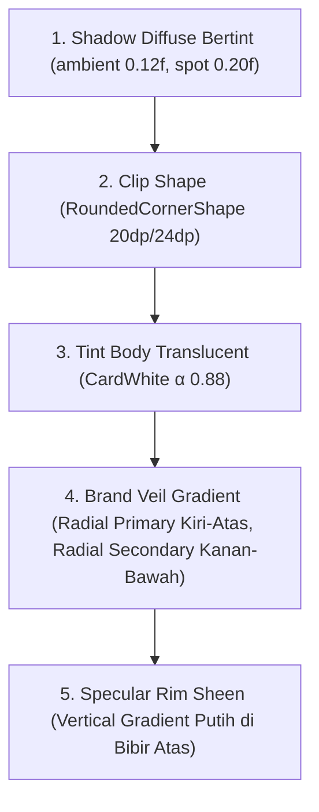
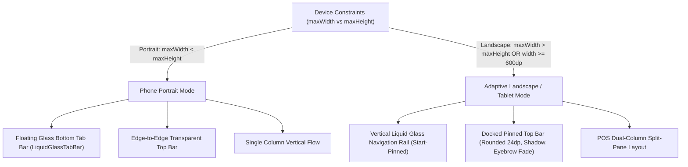

# Warung Liquid Glass Design System
## Panduan Desain & Arsitektur UI Mobile Human-Crafted (Anti AI-Slop)

> **Status**: Dokumen Resmi Arsitektur & Pedoman Desain iTalase POS & Accounting (`com.anlian.italase`)  
> **Platform Target**: Jetpack Compose (Android) & Compose Multiplatform (CMP: Android, iOS, Desktop, Web)  
> **Referensi Kode Sumber**: [`Theme.kt`](file:///c:/Users/anand/StudioProjects/iTalase/shared/src/commonMain/kotlin/com/anlian/italase/shared/ui/theme/Theme.kt), [`Common.kt`](file:///c:/Users/anand/StudioProjects/iTalase/shared/src/commonMain/kotlin/com/anlian/italase/shared/ui/components/Common.kt), [`AppNavHost.kt`](file:///c:/Users/anand/StudioProjects/iTalase/shared/src/commonMain/kotlin/com/anlian/italase/shared/ui/navigation/AppNavHost.kt)

---

## 1. Filosofi & Manifesto Anti AI-Slop

### 1.1 Masalah "AI-Slop" pada Desain Mobile
Sebagian besar antarmuka mobile yang dihasilkan AI generik mengalami pola "AI-Slop" yang seragam dan melelahkan mata pengguna:
- **Warna Neon Ungu/Biru Klise**: Gradien ungu-neon atau biru korporat dingin tanpa resonansi budaya lokal.
- **Kartu di dalam Kartu Tanpa Akhir**: *Nesting* kartu berlebihan (*cards-inside-cards-inside-cards*) yang memakan padding dan menyisakan sedikit ruang untuk konten nyata.
- **Glassmorphism Ceroboh (*Lazy Blur*)**: Menempelkan `Modifier.blur` atau *live backdrop blur* pada container yang bergulir (*scrolling list*), menyebabkan *frame drops* parah (jebol dari 60/120 FPS ke <30 FPS) pada perangkat menengah (*mid-range*) seperti Samsung Galaxy A54.
- **Border Stroke Seragam**: Memberi garis tepi 1px abu-abu atau putih solid di sekeliling semua elemen, membuat antarmuka terasa kaku, murahan, dan tidak berbobot.
- **Mengabaikan Mode Lanskap & Tablet**: Tampilan hanya diuji pada satu resolusi portrait ponsel; saat layar diputar, elemen terpotong, dialog meluap (*overflow*), dan navigasi bawah menghalangi setengah layar.

### 1.2 Filosofi Warung Liquid Glass
iTalase dibangun dengan filosofi **Warung Liquid Glass**: perpaduan antara **kehangatan budaya warung tradisional Indonesia** dengan **keanggunan fisika antarmuka Apple (Apple Fluid Interfaces)**:
1. **Kehangatan Organik Nusantara**: Terinspirasi dari kertas bungkus warung (*Paper* cream hangat), hijaunya dedaunan pasar tradisional (*Warung Emerald Green*), dan aksen keemasan rempah/marigold (*Warm Marigold*).
2. **Kaca Nyata Tanpa Penalti Kinerja**: Kaca dibentuk bukan dari stroke border, melainkan dari **pencahayaan bibir atas (*specular rim light*)**, **sorot warna brand lembut (*veil gradients*)**, dan **bayangan difusi bervolume (*diffuse elevation shadows*)**.
3. **Fisika Pegas Alami (*Fluid Spring Physics*)**: Tidak ada animasi linier kaku (*linear tweens*). Setiap penekanan, transisi masuk layar, dan interaksi tab merespon dengan fisika pegas *damping ratio* dan *stiffness* yang terkalibrasi.
4. **Desain Adaptif Kelas Satu (*First-Class Adaptive Layout*)**: Portrait ponsel, landscape ponsel (POS mode), dan layar tablet/foldable memiliki arsitektur tata letak khusus yang memanfaatkan ruang secara optimal tanpa kompromi.

---

## 2. Palet Warna & Arsitektur Kontras (WCAG AA Certified)

Setiap token warna dikalibrasi secara presisi dan menjadi *single source of truth* di [`Theme.kt`](file:///c:/Users/anand/StudioProjects/iTalase/shared/src/commonMain/kotlin/com/anlian/italase/shared/ui/theme/Theme.kt):

| Nama Token | Hex / Nilai | Peran Desain | Rasio Kontras & Alasan |
| :--- | :--- | :--- | :--- |
| **`WarungGreen`** | `#1D6B3C` | `primary` skema terang | Hijau warung pekat. Teks putih di atasnya lolos WCAG AA ($\ge 5.4:1$). |
| **`WarungGreenDark`** | `#0E3D20` | `onPrimaryContainer` | Warna teks & ikon di atas kontainer hijau muda. |
| **`WarungGreenSoft`** | `#DCEFE1` | `primaryContainer` | Aksen lembut pulau kaca tab aktif & chip status sukses. |
| **`Marigold`** | `#E8930C` | `secondary` | Kuning rempah hangat untuk aksi sekunder, diskon, dan peringatan. |
| **`MarigoldSoft`** | `#FDEBC8` | `secondaryContainer` | Latar badge galeri foto & status chip netral. |
| **`MarigoldInk`** | `#5C3800` | `onSecondaryContainer` | Teks di atas latar Marigold muda ($\ge 7:1$). |
| **`Paper`** | `#FAF6EE` | `background` skema terang | Kertas krem warung. Sengaja sedikit lebih gelap dari `CardWhite` agar pulau kaca terlihat terangkat. |
| **`CardWhite`** | `#FFFDF7` | `surface` skema terang | Putih susu hangat untuk kartu dan panel kaca. |
| **`SandLow`** | `#F3EDDE` | `surfaceVariant` | Abu pasir lembut untuk selingan dan divider halus. |
| **`InkSoft`** | `#6B6250` | `onSurfaceVariant` | Teks sekunder, label netral, dan ikon nonaktif. |

### Aturan Emas Kontras Kaca vs Latar
```
Paper (#FAF6EE) vs CardWhite (#FFFDF7) -> Beda Luminance Terukur: 1.051 : 1
```
> [!IMPORTANT]
> **Mengapa Latar App `Paper` Lebih Gelap dari Kartu `CardWhite`?**  
> Jika background dan kartu menggunakan warna putih rata yang sama (`#FFFFFF`), panel kaca akan kehilangan batas fisiknya sehingga desainer pemula tergoda menambahkan garis tepi stroke kaku. Dengan menggunakan `Paper` di latar dan `CardWhite` (alpha 0.88) di kartu, pulau kaca terbaca jelas tanpa perlu garis tepi buatan.

---

## 3. Resep Kaca Cair (*The Liquid Glass Surface Recipe*)

### 3.1 Aturan Kinerja: "Zero Live Blur Inside Scroll"
> [!WARNING]
> **Larangan Mutlak**: Jangan pernah memasang `Modifier.blur()` atau shader refraksi dinamis di dalam item `LazyColumn`, `LazyRow`, atau `Column(verticalScroll)`.  
> Pada GPU mobile, setiap frame scroll yang menggeser layer ber-blur akan memaksa *raster re-pass* penuh untuk setiap piksel di belakang kartu. Hal ini memicu *thermal throttling* dan *jank*.

### 3.2 Anatomi Modifier `glassSurface`
Kaca pada konten scrollable di iTalase dibentuk dari 4 lapisan GPU tanpa biaya *per-frame blur*:



### 3.3 Kode Sumber Resmi `Modifier.glassSurface`
```kotlin
@Composable
fun Modifier.glassSurface(
    shape: Shape = RoundedCornerShape(24.dp),
    tint: Color = MaterialTheme.colorScheme.surface,
    alpha: Float = 0.88f,
    elevation: Dp = 22.dp,
    specular: Float = 0.34f,
    veil: Boolean = true,
    onClick: (() -> Unit)? = null,
): Modifier {
    val scheme = MaterialTheme.colorScheme
    val isDark = scheme.surface.luminance() < 0.5f

    // 1. Veil Sorot Warna Brand
    val primaryVeilBrush = if (veil) {
        remember(scheme.primary) {
            Brush.radialGradient(
                colors = listOf(scheme.primary.copy(alpha = 0.06f), Color.Transparent),
                center = Offset.Zero,
                radius = 900f,
            )
        }
    } else null

    val secondaryVeilColors = if (veil) {
        remember(scheme.secondary) {
            listOf(scheme.secondary.copy(alpha = 0.04f), Color.Transparent)
        }
    } else null

    // 2. Pantulan Cahaya Bibir Kaca Atas (Specular Sheen Rim)
    val specularAlpha = if (isDark) specular * 0.4f else specular
    val specularBrush = remember(specularAlpha) {
        Brush.verticalGradient(
            0f to Color.White.copy(alpha = specularAlpha),
            0.28f to Color.Transparent,
        )
    }

    // 3. Respon Sentuh Skala Pegas Apple (0.975f)
    val clickModifier = if (onClick != null) {
        val interaction = remember { MutableInteractionSource() }
        val pressed by interaction.collectIsPressedAsState()
        Modifier
            .graphicsLayer {
                val s = if (pressed) 0.975f else 1f
                scaleX = s
                scaleY = s
            }
            .clickable(interaction, indication = null) { onClick() }
    } else {
        Modifier
    }

    return this
        .then(clickModifier)
        .shadow(
            elevation = elevation,
            shape = shape,
            ambientColor = scheme.onSurface.copy(alpha = 0.12f),
            spotColor = scheme.onSurface.copy(alpha = 0.20f),
        )
        .clip(shape)
        .drawBehind {
            // A. Base Translucent Surface
            drawRect(tint, alpha = alpha)

            // B. Dual-Radial Brand Veils
            if (primaryVeilBrush != null && secondaryVeilColors != null) {
                drawRect(primaryVeilBrush)
                drawRect(
                    Brush.radialGradient(
                        colors = secondaryVeilColors,
                        center = Offset(size.width, size.height),
                        radius = 900f,
                    ),
                )
            }

            // C. Rim Specular Top Lip
            drawRect(specularBrush)
        }
}
```

---

## 4. Pola Isolasi Backdrop Blur & Modal Dialog

### 4.1 Masalah Arsitektur Dialog di Jetpack Compose
Dialog di Compose dirender di jendela terpisah (`android.ui.window.Dialog`). Menaruh `Modifier.blur` di dalam kartu dialog justru memburamkan teks dan ikon dialog itu sendiri.

### 4.2 Solusi iTalase: Blur Scaffold Subtree Terpusat
1. Buat *singleton state* penanda dialog:
   ```kotlin
   internal object GlassDialogBackdrop {
       var open: Boolean by mutableStateOf(false)
   }
   ```
2. Sambungkan ke Scaffold utama di [`AppNavHost.kt`](file:///c:/Users/anand/StudioProjects/iTalase/shared/src/commonMain/kotlin/com/anlian/italase/shared/ui/navigation/AppNavHost.kt):
   ```kotlin
   Scaffold(
       modifier = Modifier.blur(
           if (confirmExit || GlassDialogBackdrop.open) 20.dp else 0.dp
       ),
       containerColor = Color.Transparent,
       contentWindowInsets = WindowInsets(0.dp),
   )
   ```
3. Di dalam dialog, pasang pengumuman otomatis:
   ```kotlin
   @Composable
   internal fun AnnounceGlassDialogOpen() {
       DisposableEffect(Unit) {
           GlassDialogBackdrop.open = true
           onDispose { GlassDialogBackdrop.open = false }
       }
   }
   ```
> [!TIP]
> Dengan pola ini, konten aplikasi di belakang dialog diburamkan secara seragam (20dp blur), sehingga kartu dialog dapat menggunakan alpha yang sangat jernih (`0.54f`) tanpa ada teks latar yang bertabrakan.

---

## 5. Tata Letak Multi-Orientasi & Desain Adaptif

iTalase mendukung secara penuh mode **Portrait** ponsel, **Landscape** ponsel (POS mode meja kasir), dan **Tablet/Foldable**.



### 5.1 Navigasi: Bottom Tab Bar vs Navigation Rail
- **Portrait**: Menggunakan `LiquidGlassTabBar` mengambang di bawah layar dengan *fade scrim* 44dp di belakangnya.
- **Landscape**: Tab bar horizontal memakan ruang vertikal yang sangat berharga di ponsel. Oleh karena itu, antarmuka otomatis beralih ke `LiquidGlassNavRail` selebar 72dp di sisi kiri yang menyatu dengan *cutout* & *status bar insets*.

### 5.2 Top App Bar Dinamis (`PremiumTopBar`)
Top bar iTalase beradaptasi secara cerdas berdasarkan orientasi dan status scroll:

```kotlin
// Perhitungan offset di AppNavHost
val rawOffset = topBarState.behaviors[current]?.state?.contentOffset ?: 0f
val frostOffset = if (Routes.isFullPageScrollable(current)) rawOffset else 0f
```

- **Perilaku di Mode Portrait**:
  - Saat konten digulir, bar bertransisi mulus dari transparan ke latar *frosted glass* ($\alpha = 0.97$).
  - Memancarkan garis *specular rim* 1px putih di tepi bawah (`Color.White.copy(alpha = 0.60f * glass)`).
  - Judul melakukan *docking scale-down* (`1.0f -> 0.96f`).
- **Perilaku di Mode Landscape (Adaptive Layout)**:
  - Top bar berubah bentuk menjadi pulau mengambang kompak dengan sudut bawah membulat (`RoundedCornerShape(bottomStart = 24.dp, bottomEnd = 24.dp)`).
  - *Eyebrow* memudar (*fade-out*) dan menyusut (*height collapse*) otomatis saat scroll, sehingga bar bertransformasi menjadi *single-line pinned header*.
  - Padding vertikal menyempit secara dinamis (`topPad` menyusut 50%, `bottomPad` menyusut 40%).

### 5.3 Paradigma POS Split-Pane
Pada layar lanskap, layar utama dibagi menjadi 2 kolom dengan rasio yang seimbang:
1. **Layar Kasir (`CashierScreen`)**:
   - *Kolom Kiri (Weight 1.2f)*: Filter kategori chip + katalog grid produk.
   - *Kolom Kanan (Weight 0.8f)*: Panel ringkasan keranjang belanja sticky + tombol bayar.
2. **Layar Beranda (`DashboardScreen`)**:
   - *Kolom Kiri (Weight 1.05f)*: Hero omzet harian + aksi cepat + 4 kartu statistik kaca.
   - *Kolom Kanan (Weight 0.95f)*: Daftar produk terlaris + peringatan stok rendah.
3. **Layar Pengaturan & QRIS (`PaymentSettingsScreen` / `QrisReviewScreen`)**:
   - *Kolom Kiri (Weight 1.15f)*: Toggle switch + penampil pratinjau barcode QRIS toko.
   - *Kolom Kanan (Weight 0.85f)*: Panduan SOP pembayaran warung & edukasi keamanan.

---

## 6. Fisika Gerak Apple & Mikro-Interaksi

### 6.1 Respon Sentuh Pegas (*Touch Feedback*)
Jangan gunakan *ripple effect* persegi Material standar di atas permukaan kaca. Gunakan *press-scale* berbasis `graphicsLayer`:
- **Kartu Kaca (`GlassCard`)**: `scale = 0.975f` saat ditekan.
- **Item Tab / Nav Rail**: `scale = 0.94f` saat ditekan.
- **Tombol Kembali / Ikon Bulat**: `scale = 0.88f` saat ditekan dengan `Spring.DampingRatioMediumBouncy`.

### 6.2 Animasi Masuk Bertahap (*Cascading Enter Transition*)
```kotlin
@Composable
fun Modifier.enter(visible: Boolean, index: Int): Modifier {
    val progress by animateFloatAsState(
        targetValue = if (visible) 1f else 0f,
        animationSpec = tween(
            durationMillis = 380,
            delayMillis = (index * 45).coerceAtMost(220),
            easing = CubicBezierEasing(0.16f, 1f, 0.3f, 1f), // Apple Decelerate
        ),
        label = "enter$index",
    )
    return this.graphicsLayer {
        alpha = progress
        translationY = (1f - progress) * 16.dp.toPx()
        scaleX = 0.985f + (progress * 0.015f)
        scaleY = 0.985f + (progress * 0.015f)
    }
}
```

---

## 7. Katalog Komponen Siap Pakai

Berikut adalah implementasi referensi untuk komponen-komponen inti:

### 7.1 `GlassCard`
```kotlin
@Composable
fun GlassCard(
    modifier: Modifier = Modifier,
    shape: Shape = RoundedCornerShape(24.dp),
    tint: Color = MaterialTheme.colorScheme.surface,
    alpha: Float = 0.88f,
    onClick: (() -> Unit)? = null,
    content: @Composable BoxScope.() -> Unit,
) {
    Box(
        modifier = modifier.glassSurface(shape = shape, tint = tint, alpha = alpha, onClick = onClick),
        content = content,
    )
}
```

### 7.2 `GlassButton` (Pill Button)
```kotlin
@Composable
fun GlassButton(
    text: String,
    onClick: () -> Unit,
    modifier: Modifier = Modifier,
    container: Color = MaterialTheme.colorScheme.primary,
    content: Color = MaterialTheme.colorScheme.onPrimary,
    enabled: Boolean = true,
    height: Dp = 48.dp,
    elevation: Dp = 10.dp,
    specular: Float = 0.30f,
) {
    Box(
        modifier = modifier
            .height(height)
            .glassSurface(
                shape = CircleShape,
                tint = if (enabled) container else MaterialTheme.colorScheme.surfaceContainerHigh,
                alpha = if (enabled) 0.94f else 0.92f,
                elevation = if (enabled) elevation else 0.dp,
                specular = if (enabled) specular else 0f,
                veil = false,
                onClick = if (enabled) onClick else null,
            )
            .padding(horizontal = 20.dp),
        contentAlignment = Alignment.Center,
    ) {
        Text(
            text = text,
            fontWeight = FontWeight.Bold,
            color = if (enabled) content else MaterialTheme.colorScheme.onSurface.copy(alpha = 0.72f),
            maxLines = 1,
        )
    }
}
```

### 7.3 `StatusChip`
```kotlin
@Composable
fun StatusChip(text: String, good: Boolean) {
    Surface(
        shape = CircleShape,
        color = if (good) MaterialTheme.colorScheme.primaryContainer
                else MaterialTheme.colorScheme.secondaryContainer,
    ) {
        Text(
            text = text,
            modifier = Modifier.padding(horizontal = 12.dp, vertical = 6.dp),
            style = MaterialTheme.typography.labelSmall,
            fontWeight = FontWeight.Bold,
            color = if (good) MaterialTheme.colorScheme.onPrimaryContainer
                   else MaterialTheme.colorScheme.onSecondaryContainer,
        )
    }
}
```

---

## 8. Checklist Verifikasi Anti AI-Slop (Audit Gate)

Sebelum menandai sebuah antarmuka selesai, lakukan audit terhadap 7 butir pemeriksaan berikut:

- [ ] **Tidak Ada Border Stroke Kaku**: Komponen tidak menggunakan `border = BorderStroke(1.dp, Color.Gray)`. Efek batas murni dibentuk dari specular rim atau kontras luminance Paper vs CardWhite.
- [ ] **Zero Live Blur dalam Scroll**: Tidak ada `Modifier.blur()` pada kartu di dalam LazyColumn/scroll list. Blur hanya di Scaffold overlay dialog.
- [ ] **Uji Rotasi Layar (Landscape & Portrait)**: Layar telah diuji pada orientasi landscape. Dialog tidak overflow dan form input memakai `imePadding()`.
- [ ] **Transisi Berbobot (Apple Springs)**: Klik tombol dan kartu menggunakan *press-scale* (`0.975f` / `0.94f`), bukan ripple kotak.
- [ ] **Palet Budaya Warung Asli**: Warna dominan adalah `WarungGreen` (`#1D6B3C`), `Paper` (`#FAF6EE`), dan `CardWhite` (`#FFFDF7`). Tidak ada gradien ungu generik.
- [ ] **Kontras Teks Terverifikasi**: Teks sekunder terbaca dengan rasio minimal $4.5:1$ (WCAG AA). Teks di panel dialog terbaca jernih di atas latar yang diburamkan.
- [ ] **Top Bar Docking Adaptif**: Layar berhalaman penuh terdaftar di `Routes.FULL_PAGE_SCROLL_ROUTES` sehingga top bar membeku dan menempel mulus saat digulir.
